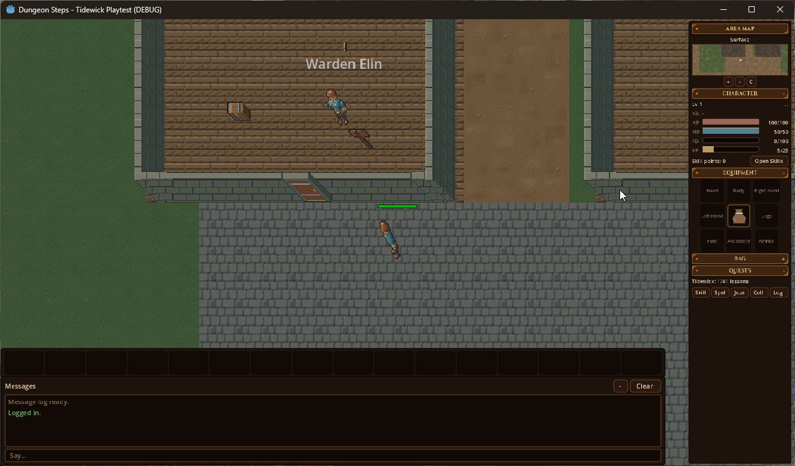
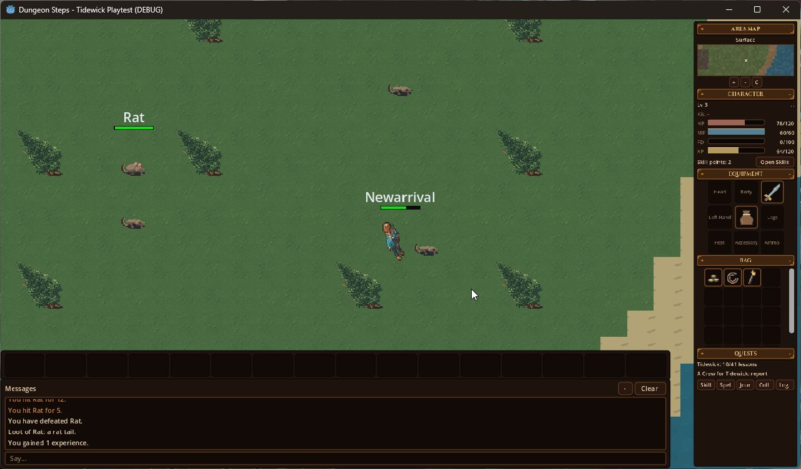
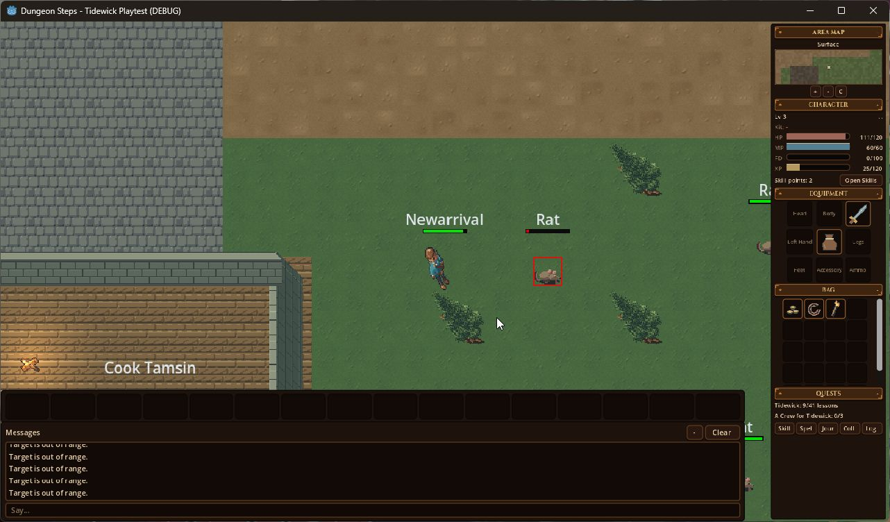
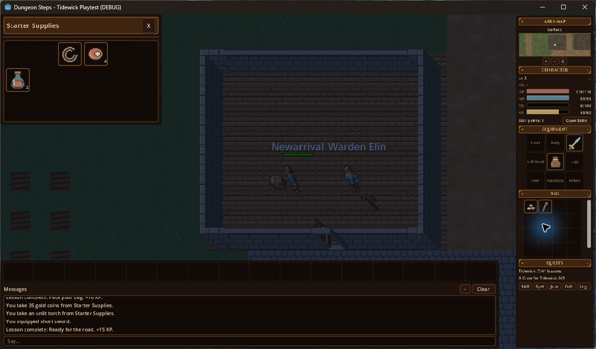
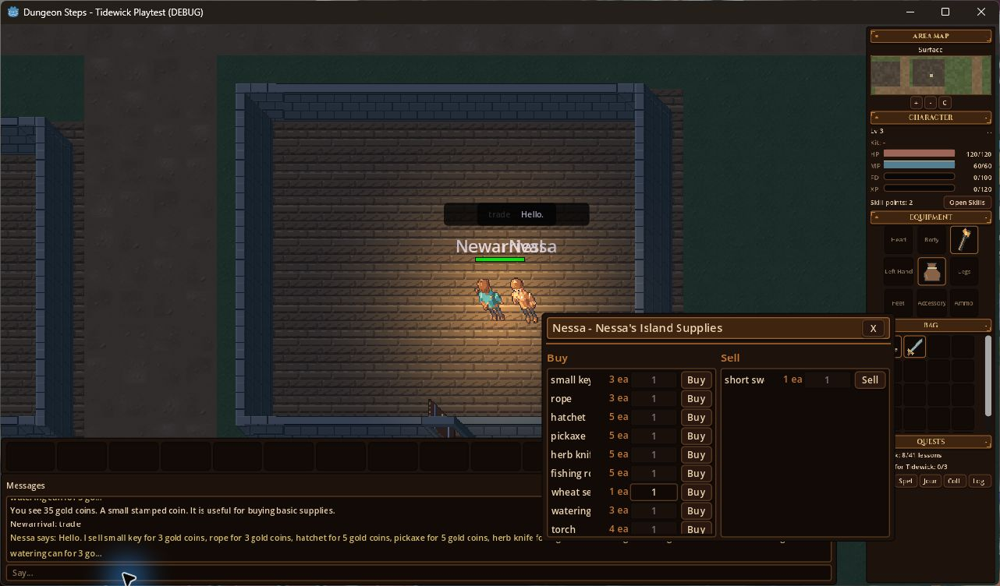
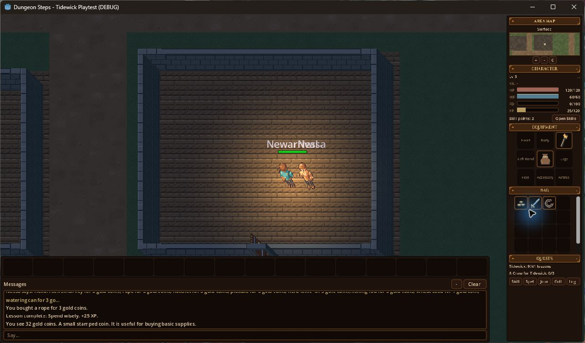
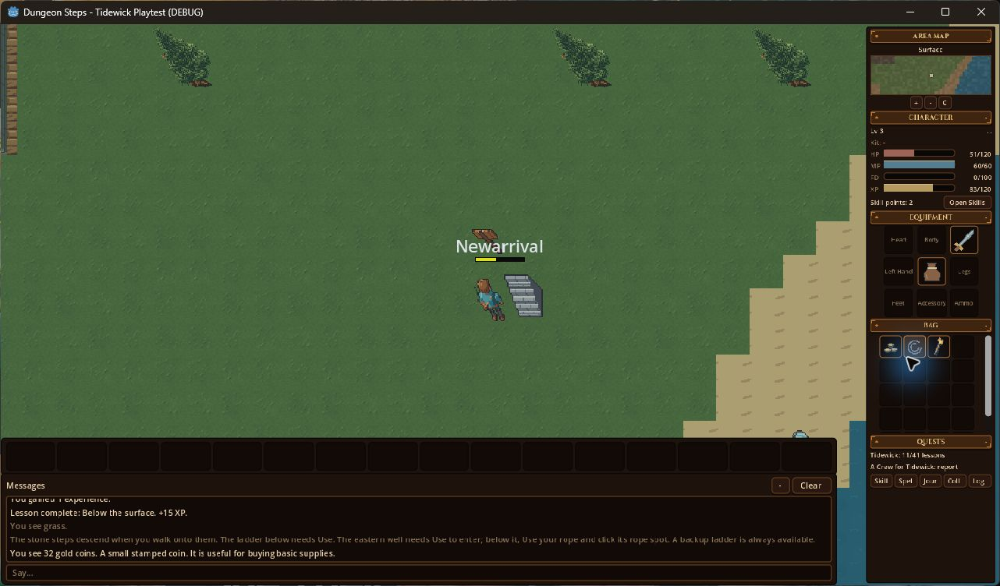

# Dungeon Steps

**An AI-assisted, MMO-style RPG prototype exploring connected gameplay systems and persistent character progress.**

I'm Chase. I choose the direction and features and use AI assistance to implement and refine the project. This showcase presents a working slice of Tidewick: exploration, combat feedback, supplies, equipment, shops, and saving character progress.

This repository contains screenshots and documentation only. Application source, account data, and raw save files are not published here. There is no public download or hosted game attached to this showcase.

## Explore Tidewick

Actual gameplay captures from September 26, 2026, using the isolated Newarrival test character in a Godot debug build.

## Connected gameplay

Combat produces hit, defeat, loot, and experience messages. The same session included collecting starter supplies, equipping a short sword, using a torch, and using stairs.

Combat in progress and starter equipment

## Playtest: buy one rope

**Expected:** buying one rope priced at 3 gold from a balance of 35 should leave 32 gold and add the rope to the bag.

**Observed:** the before capture shows 35 gold and the 3-gold price. The after capture shows the purchase message, rope in the bag, and 32 gold. The shop was closed afterward to reveal the inventory. The coin Look action was used to display the balance in chat.

| Before purchase | After purchase |
| --- | --- |
|  |  |

**Result:** the displayed item and balance matched the expected transaction in this test.

## Playtest: save and return

The ordinary sidebar Logout button returned to the account screen. A fresh game process then loaded the same isolated character.

| Before logout | After fresh-process reload |
| --- | --- |
|  |  |

The captures show the sword and backpack equipped, coins/rope/torch in the bag, 32 gold, level 3, 83 XP, 51 HP, and 11 completed lessons. The playtest's saved comparison report records matching inventory, equipment, level, experience, health, mana, position/floor, quest, and tutorial fields.

**Result:** the inspected character state persisted through this reload. The isolated test setup automatically entered the character and bypassed account authentication; this was not a sign-in test.

## How this was tested

This was a shared player/AI playtest with shared controls, not a wholly independent manual test by me. I participated in the session; AI assistance supported operation, captures, and the saved-state comparison. The supplied playtest notes and screenshots were reviewed for this showcase. No new gameplay or full automated test suite was run during publication.

The session ended with 11 of 41 lessons complete and the three-rat quest ready to report. It did not validate the full tutorial, two-client synchronization, remote connections, server capacity, or production readiness. MMO-style describes the project's direction, not a demonstrated player count.

## Issues found during playtesting

- The shop lacks a clear money total, truncates item names, and overlaps the bag.
- Nessa's context-menu Trade action was disabled; saying `trade` opened the shop.
- Equipping a torch replaced the sword in the right hand; an attempted drag to the left hand did not move it.
- Repeated out-of-range messages cluttered combat chat.
- Walls could obscure the character near their south edge.
- The session notes recorded a blocked-movement warning with a backtrace, without a crash.

These are observations from this session, not claims that the issues have been fixed. They provide concrete next steps for improving the prototype and repeating the checks.

## Status

Work in progress. This showcase demonstrates a bounded gameplay slice and its current rough edges. It does not claim a finished MMO or independently authored code.

[More of my projects](https://github.com/chaser777f)
